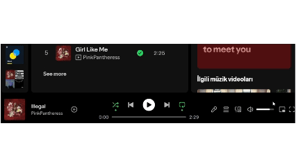

[Click here for Turkish documentation](./README.tr.md)

# Spotify-SoundCloud Comment Extension

A Chrome extension that automatically detects the track playing on **Spotify Web Player**, finds a matching track on **SoundCloud**, and shows real-time timestamped comments right above the player bar.

## Features

- **Automatic Track Detection:** Automatically detects the playing song and artist on Spotify Web Player and starts the process.
- **Track Matching (Important):** Since a song on Spotify can have dozens of copies, remixes, or edits on SoundCloud, it scores tracks and picks the highest-scoring one based on label/publisher, duration similarity, genre, tags, and metadata. (Note: no matter how much I try, SoundCloud sometimes returns every remix except the original track :D You can check the console logs to see if it picked the right one. A bit annoying, still haven't found a proper fix for it...)
- **Time-Synced Comments:** Matches comments closest to the current playback time and displays them on screen.
- **Automatic ClientID Capture:** The extension needs a SoundCloud `client_id` to work. Instead of digging through network requests and entering it manually, just open SoundCloud and wait a few seconds so `client_id` gets captured and saved to `chrome.storage.local`.

## Installation

1. Download or clone the repo (`git clone https://github.com/archeriaa/spotify-sc-comments.git`).
2. Go to `chrome://extensions/` in Chrome and turn on **Developer mode** in the top-right corner.
3. Click **Load unpacked** and select the project folder.
4. Open [SoundCloud](https://soundcloud.com) and wait a few seconds so `client_id` is saved.
5. Open [Spotify Web Player](https://open.spotify.com) and play a track.

## Notes

- Some timer class names in the Spotify UI can change after updates and may need to be updated manually.
- It uses SoundCloud's internal `api-v2` endpoints, so rate limits or changes can happen under heavy requests.
- This code is written purely for fun; any breakage or rate limits on your side are on you.
- I haven't hit a rate limit or breakage while testing it :-)
- I am still a beginner, so feel free to give suggestions or open a PR :))

> **Disclaimer:** This project is not affiliated with, endorsed by, or sponsored by Spotify or SoundCloud. All trademarks belong to their respective owners.

